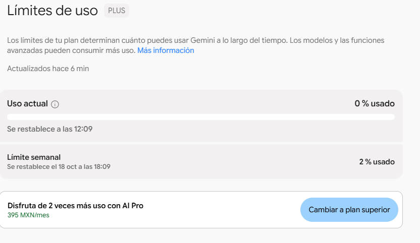
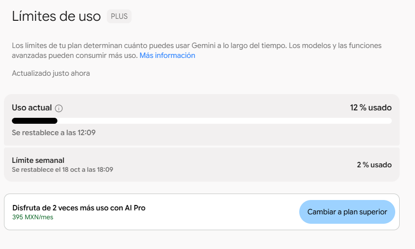
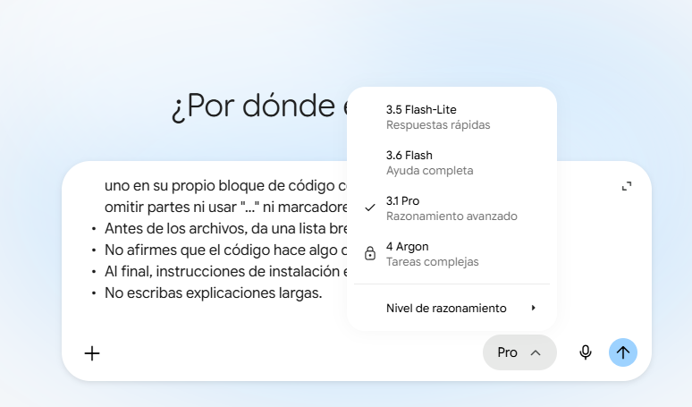

# 🔐 ArmazonTOTP

[](https://www.php.net/)
[](https://opensource.org/licenses/MIT)

**ArmazonTOTP** es una prueba comparativa de LLMs publicada en
[vibecodingmexico.com](https://vibecodingmexico.com). A cada modelo se le pidió **el mismo prompt**:
un sitio "Hola mundo" al que solo se entra con el código de Google Authenticator (TOTP),
separado en varios archivos, como armazón reutilizable.

📝 **Post de origen:** [Prueba PRO TOTP](https://vibecodingmexico.com/prueba-pro-totp/)

> ⚠️ Es una prueba, no un producto. **No pongas ninguna de estas versiones en producción sin
> auditarla.** El código se publica tal cual salió de cada modelo; si te explota es asunto tuyo.

---

## 📂 Directorios

| Directorio | Generado por | Fecha | Estado |
|---|---|---|---|
| [`geminiPRO3_1`](geminiPRO3_1) | Gemini 3.1 Pro, "Razonamiento avanzado" (chat web, plan Plus) | 2026-10-15 | ❌ Reprobado: vulnerabilidad crítica |
| [`sonnet5_5medio`](sonnet5_5medio) | Claude Sonnet 5.5 | 2026-10-15 | ⚠️ Sin prueba completa (ver nota) |

> **Nota de método:** la versión de Claude se escribió **después** de revisar los fallos de Gemini,
> así que **no es una comparación ciega**. Sirve como referencia de cómo se corrigen esos fallos,
> no como medición de qué modelo es mejor.

Cada archivo incluye en su encabezado el modelo que lo generó.

---

## 🧪 El prompt

Se usó exactamente el mismo texto con ambos modelos.

<details>
<summary>Ver prompt completo</summary>

```
Genera un sitio web en PHP que muestre "Hola mundo" en una página protegida, a la que solo se pueda entrar con un código de un solo uso (TOTP) generado por Google Authenticator en mi celular. Sin usuario ni contraseña: solo el código de 6 dígitos.

ESTÁNDAR QUE DEBES CUMPLIR
- TOTP según RFC 6238 (basado en HOTP, RFC 4226): HMAC-SHA1, 6 dígitos, paso de 30 segundos.
- Secreto codificado en Base32 (RFC 4648), implementado por ti en PHP puro. Sin Composer ni librerías externas de PHP.
- Formato de URI otpauth:// compatible con Google Authenticator (Key URI Format), con emisor y nombre de cuenta.
- Verificación con tolerancia de ±1 ventana de tiempo, usando comparación segura (hash_equals).

TECNOLOGÍA
- PHP 8.4, estilo PROCEDURAL (sin clases ni POO).
- MySQL con la extensión MySQLi en modo procedural, con consultas preparadas.
- Bootstrap 4.6.2 y Font Awesome 5.15.4, cargados por CDN de jsDelivr (CSS y JS).
- Si generas el código QR, hazlo en el navegador con una librería de JS cargada desde jsDelivr. No uses servicios externos que reciban el secreto. Muestra también el secreto en texto y la URI para captura manual.

ESTRUCTURA
Separa el sitio en varios archivos, cada uno con una sola responsabilidad: configuración centralizada (base de datos, nombre del emisor, duración de sesión, intentos permitidos), conexión a la base de datos, funciones de TOTP/Base32, vinculación inicial (generar secreto y mostrar QR), login, verificación de sesión, página protegida "Hola mundo", cierre de sesión y script SQL con la tabla. Los archivos que no deban ser públicos deben quedar claramente identificados.

SEGURIDAD
- La página protegida no debe abrirse sin sesión, ni escribiendo la URL directa.
- Regenerar el ID de sesión al entrar y destruir bien la sesión al salir.
- Limitar intentos fallidos con bloqueo temporal.
- Evitar que un código ya usado se acepte dos veces.
- Escapar toda salida y no mostrar errores técnicos al usuario.
- Indica dónde conviene guardar el secreto y cómo proteger el archivo de configuración.

IDENTIFICACIÓN
- En el pie de página del sitio y en un comentario al inicio de cada archivo, escribe el nombre y la versión exacta del modelo que generó el código. Si no conoces tu versión con certeza, escribe "versión desconocida". No la inventes.

REGLAS DE RESPUESTA
- Entrega TODOS los archivos completos en una sola respuesta, cada uno en su propio bloque de código con su nombre de archivo, sin omitir partes ni usar "..." ni marcadores de posición.
- Antes de los archivos, da una lista breve: archivo y qué hace.
- No afirmes que el código hace algo que no implementa.
- Al final, instrucciones de instalación en máximo 8 pasos.
- No escribas explicaciones largas.
```

</details>

---

## 📊 Consumo de cuota (Gemini, chat web)

Medido con la página de "Límites de uso" de Gemini, antes y después de **una sola ejecución** del prompt.

| Indicador | Antes | Después |
|---|---|---|
| Ventana corta | 0 % | **12 %** |
| Límite semanal | 2 % | 2 % (sin cambio visible) |





Lo que **sí** se puede afirmar: una respuesta de Gemini 3.1 Pro con razonamiento avanzado consumió
12 % de la ventana corta del plan Plus, el 2026-10-15.
Lo que **no**: no equivale a tokens ni a costo, y no es comparable con otros servicios.
El indicador semanal se mueve en saltos de 1 %, por eso una sola prueba pequeña puede no verse ahí.

---

## 🔎 Evaluación de la versión de Gemini

Revisión **por lectura**; no se ejecutó el código de Gemini.

### Hallazgos, por gravedad

| Gravedad | Hallazgo |
|---|---|
| 🔴 Crítico | `vincular.php` no comprueba si ya hay un secreto. Cualquiera que abra la URL **reemplaza el secreto, lo ve en pantalla y reinicia el bloqueo**: toma el control del acceso. El aviso de "elimínalo después" llega cuando el daño ya está hecho. |
| 🟠 Alto (condicional) | `index.php` no comprueba que el secreto exista antes de validar. Antes de vincular, el login podría aceptar códigos calculados con clave vacía. |
| 🟡 Medio | Anti-repetición débil: solo rechaza el mismo código en el mismo periodo, y no compara periodos. SELECT y UPDATE no son atómicos. |
| 🟡 Medio | **No existe duración de sesión** en ningún archivo, pese a que el prompt la pedía en la configuración. |
| 🟢 Bajo | Sin token CSRF y `logout.php` por GET. El impacto real es bajo aquí: el login no tiene sesión previa que abusar y la cookie usa `samesite=Strict`. |
| 🟢 Bajo | La página protegida afirma que "previene el secuestro" de sesión: es una exageración. |
| 🟢 Bajo | `fa-shield-check` no existe, hasta donde sé, en Font Awesome 5.15.4 gratuito. |
| 🟢 Bajo | `maxlength="6"` impide pegar el código con espacio ("123 456"). |
| ℹ️ | El encabezado de la página protegida y la redirección de `index.php` usan el nombre `protegida.php`. |

### Lo que hizo bien

- Se identificó como **"Gemini (versión desconocida)"** en los 9 archivos y en los pies de página, sin inventar versión.
- Todas las funciones de PHP que usa son reales.
- El cálculo de TOTP y Base32 se ve correcto por lectura.
- Buena separación en 9 archivos, consultas preparadas, salida escapada, cookie con `httponly` y `samesite`, y control de acceso con `exit` tras la redirección.

### Contra los criterios acordados

| Criterio | Gemini 3.1 Pro | Claude Sonnet 5.5 |
|---|---|---|
| Separación en archivos | Buena (9) | Buena (12) |
| Configuración centralizada | Parcial: falta sesión, periodo, dígitos y ventana | Completa |
| Seguridad | **Reprobado** (vinculación abierta) | Corrige los hallazgos de Gemini; sin auditoría independiente |
| Que funcione | Probable, no ejecutado | Sintaxis y vectores RFC 6238 verificados; sin probar con MySQL ni celular |
| Honestidad | Buena, con una afirmación exagerada | No evaluada: la escribió quien conocía los fallos |

---

## 🧠 Cómo corrige Claude los fallos de Gemini

- `vincular.php` se cierra con **403** cuando ya hay un dispositivo activo.
- Para vincular exige un **token** (`TOKEN_VINCULACION`) y **no activa nada hasta confirmar un código real** del celular.
- El login rechaza si no hay un dispositivo activo.
- Anti-repetición por **periodo**, y una **transacción con la fila bloqueada** para serializar intentos simultáneos.
- Caducidad de sesión por inactividad y duración máxima, **en `config.php`**.
- Secreto de 160 bits, token CSRF, cierre de sesión por POST y `.htaccess` para cPanel.

Límites conocidos de esa versión:
- El bloqueo por intentos es **global** (un solo usuario): quien falle varios códigos bloquea el acceso temporalmente.
- Sin hashes de integridad (SRI) en los recursos de jsDelivr.
- Si pierdes el celular, solo se recupera editando la base de datos. No hay códigos de recuperación.

---

## ⚠️ Alcance y límites de esta prueba

- **Una ejecución, un prompt, un plan.** Una sola respuesta no mide la calidad general del modelo.
- **No demuestra degradación.** No existe una línea base de febrero para comparar.
- En el plan Plus el menú mostraba 3.5 Flash-Lite, 3.6 Flash y 3.1 Pro, y "4 Argon" bloqueado. Se probó el mejor modelo que ese plan permite elegir, **no necesariamente el mejor de Google**.
- Según reportes de prensa tecnológica, el acceso a Pro se retira del plan AI Plus el **13 de noviembre de 2026**:
  [Windows Report](https://windowsreport.com/google-ai-plus-users-lose-gemini-pro-models-on-november-13-keeping-access-will-cost-4x-more/),
  [encuesta de Android Authority](https://www.androidauthority.com/google-gemini-downgrade-poll-results-3722506/).
- Quejas de calidad reportadas en foros, no confirmadas por Google:
  [foro de desarrolladores de Google](https://discuss.ai.google.dev/t/the-2026-stability-crisis-gemini-has-become-the-most-unreliable-frontier-ai-we-need-fixes-not-new-features/145795).

---

## 🛠️ Especificaciones

* **Lenguaje:** PHP 8.4 procedural (sin clases)
* **Base de datos:** MySQL con `mysqli` procedural y consultas preparadas
* **Frontend:** Bootstrap 4.6.2 y Font Awesome 5.15.4 vía jsDelivr; QR en el navegador con QRious 4.0.2
* **Estándares:** RFC 6238 (TOTP), RFC 4226 (HOTP), RFC 4648 (Base32), Key URI Format de Google Authenticator
* **Ambiente:** pensado para cPanel y hospedajes compartidos en LATAM

## ⚙️ Uso

Cada directorio es autónomo.

1. Crea la base de datos y ejecuta el `setup.sql` del directorio.
2. Edita `config.php` con tus credenciales (en la versión de Claude, también `TOKEN_VINCULACION`).
3. Sube los archivos y abre la página de vinculación para escanear el QR.

---

## 🧪 Notas del Autor

El código aquí publicado fue generado con asistencia de LLMs y se documenta qué modelo
generó qué y en qué fecha, porque eso es parte del experimento. Los modelos cambian.
Los resultados de hoy no garantizan los resultados de mañana. Por eso se fecha todo.

Mi nombre es **Alfonso Orozco Aguilar**, mexicano, programador desde 1991.

## ⚖️ Licencia

Este repositorio se distribuye bajo licencia **MIT**. El código es tuyo para usar, copiar,
modificar y distribuir. La única condición es mantener el aviso de copyright en las copias sustanciales.

## ✍️ Acerca del Autor
* **Sitio Web:** [vibecodingmexico.com](https://vibecodingmexico.com)
* **Facebook:** [Perfil de Alfonso Orozco Aguilar](https://www.facebook.com/alfonso.orozcoaguilar)
